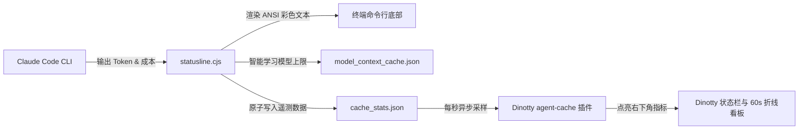

# ⚡ Claude Pulse

<p align="center">
  <b>Universal Multi-Protocol Statusline, Intelligent Context Self-Learning & Telemetry Suite for Claude Code</b><br>
  <i>全协议通用缓存监控 · 模型上下文智能自学习状态栏 · Dinotty 终端原生插件系统</i>
</p>

<p align="center">
  
  
  
  
  
  
</p>

---

## 📖 简介 / Overview

**Claude Pulse** 是一套专为 **Claude Code CLI** 与现代开发终端（如 **Dinotty**）打造的零依赖、高精度状态栏与遥测套件。

无论你使用的是 Anthropic 原生 Claude 模型，还是通过 **CC Switch / 聚合网关** 接入的 **DeepSeek、GPT、GLM、Gemini** 等第三方模型，Claude Pulse 都能精准捕获缓存命中率、自动学习模型上下文上限，并将数据实时同步至外部终端。

```text
 📦 DeepSeek 4.1 Flash │ Ctx [■■■■□□□□] 56.6% (72.5k/128k) │ 💾 Cache 96% (64.8k) │ ⚡ 1.5 TPS │ 📁 main
```

*(Dinotty 终端右下角状态栏同步点亮)*:
```text
 [⚡ Cache 96% (64.8k)]  ── 点击展示 60s 走势折线图与 Token 消耗明细
```

---

## 🌟 核心特性 / Features

### 1. ⚡ 全协议缓存命中率引擎 (Multi-Protocol Cache Engine)
彻底解决传统状态栏插件（如 `ccstatusline`）在非 Anthropic 模型下显示破损横杠 `💾 Cache —` 的通病。全面兼容：
- **Anthropic 官方协议**：`cache_read_input_tokens` / `cache_creation_input_tokens`
- **OpenAI Chat Completions 协议**：`prompt_tokens_details.cached_tokens`
- **OpenAI Responses 协议**：`input_tokens_details.cached_tokens`
- **Google Gemini 原生协议**：`cachedContentTokenCount`
- **DeepSeek Context Cache 协议**：精准折算 90% 缓存折扣收益与节省 Token

### 2. 🧠 四级上下文智能自学习 (Universal Context Self-Learning)
无需手动配置模型参数，未来任何新发布模型均可自动适配：
1. **显式容量声明**：优先继承 CC Switch 等网关的“声明支持 1M/2M”定义；
2. **本地模型库反查**：自动扫描本机的 CC Switch 与 Codex 模型库索引；
3. **命名规则动态萃取**：自动从模型后缀识别 `-128k`、`-256k`、`-1m`、`-4m`；
4. **自适应溢出阶梯**：当实际消耗超过预估时，按业界标准硬件阶梯（16k/32k/64k/128k/256k/512k/1M/2M/4M/10M）无感平滑向上扩展，永不爆条（`>100%`），并持久化记忆至 `model_context_cache.json`。

### 3. 🖥️ Dinotty 终端原生插件 (Native Dinotty Plugin)
- 完美契合新一代跨平台终端 **Dinotty** 的插件系统；
- 底部状态栏原生展示 `⚡ Cache XX% (XXk)`；
- 点击弹出 **60 秒实时趋势折线图** 与包含输入、输出、缓存量、模型、TPS、更新时长的精致看板。

### 4. 🛡️ CC Switch 防冲刷保护 (CC Switch Lockdown)
内置专门的 SQLite 配置维护脚本，自动为 CC Switch 中的全部 Claude 供应商注入状态栏保护，即使在 CC Switch 界面中频繁切换通道，也**绝不丢失状态栏配置**。

### 5. 🚀 零依赖 · 亚毫秒极速响应 (Zero-Dependency & Sub-millisecond)
- 100% 采用 Node.js 原生标准库，无 `node_modules` 负担；
- 执行耗时小于 5ms，全流程静默容错保护，任何异常均平稳退化，永不阻断 Claude Code 主流程。

---

## 📂 项目结构 / Structure

```text
claude-pulse/
├── install.ps1                 # Windows 一键自动安装脚本 (PowerShell)
├── install.sh                  # macOS / Linux 一键自动安装脚本 (Bash)
├── package.json                # 项目元数据
├── LICENSE                     # MIT 开源协议
├── scripts/
│   ├── statusline.cjs          # 状态栏核心引擎 (多协议提取 + 自学习上下文 + 实时遥测)
│   └── patch-ccswitch.py       # CC Switch 供应商配置自动锁定脚本
└── dinotty-plugin/
    └── agent-cache/            # Dinotty 终端原生插件
        ├── plugin.json         # 插件清单
        ├── main.js             # 响应式状态管理 + 状态栏 Series + Popover 走势图
        └── README.md
```

---

## 🚀 快速开始 / Quick Start

### 方式一：Windows 一键安装 (推荐)

在当前仓库根目录下，打开 PowerShell 执行：

```powershell
.\install.ps1
```

> **脚本会自动完成**：
> 1. 检测 Node.js 运行时环境；
> 2. 将状态栏引擎安装至 `~/.claude/statusline.cjs`；
> 3. 无损更新 `~/.claude/settings.json` 的 `statusLine` 配置；
> 4. 若检测到 Dinotty 终端，自动安装 `agent-cache` 插件；
> 5. 若检测到 CC Switch，自动批量注入保护各渠道配置。

### 方式二：macOS / Linux 一键安装

在终端执行：

```bash
chmod +x ./install.sh
./install.sh
```

---

### 方式三：手动配置 (Manual Setup)

1. 将 `scripts/statusline.cjs` 复制到用户主目录下的 `.claude` 文件夹：
   ```bash
   cp scripts/statusline.cjs ~/.claude/statusline.cjs
   ```
2. 编辑 `~/.claude/settings.json`，在最外层加入 `statusLine`：
   ```json
   {
     "statusLine": {
       "type": "command",
       "command": "node C:/Users/<你的用户名>/.claude/statusline.cjs",
       "padding": 0
     }
   }
   ```
   *(macOS/Linux 请将路径替换为 `node ~/.claude/statusline.cjs`)*

3. **(可选) 启用 Dinotty 插件**：
   将 `dinotty-plugin/agent-cache` 文件夹复制到：
   - **Windows**: `%USERPROFILE%\.dinotty\plugins\agent-cache`
   - **macOS / Linux**: `~/.dinotty/plugins/agent-cache`

4. **(可选) 锁定 CC Switch 渠道**：
   ```bash
   python scripts/patch-ccswitch.py
   ```

---

## 📊 遥测数据流 / Architecture



---

## 🛠️ 常见问题 / FAQ

#### Q: 为什么我在第三方模型（如 DeepSeek）下也可以看到缓存命中率？
A: 标准的 Claude 状态栏插件只认 `cache_read_input_tokens` 字段，而第三方中转和 OpenAI 兼容接口会将缓存数据放在 `prompt_tokens_details.cached_tokens` 中。Claude Pulse 内部实现了全协议聚合器，抹平了各供应商之间的字段差异。

#### Q: 切换模型后上下文长度不对怎么办？
A: Claude Pulse 会自动分析模型名称并在对话产生后自学习。如果模型名称非常特殊（未携带 128k/1M 等字样），系统会在 Token 增长时自动沿阶梯无感扩展，并把学到的结果保存在 `~/.claude/model_context_cache.json` 中，越用越准。

#### Q: 在 CC Switch 切换渠道后，状态栏会丢失吗？
A: 不会。通过运行 `python scripts/patch-ccswitch.py`，所有 Claude 渠道的配置已被永久锁定挂载本脚本。

---

## 📄 开源许可证 / License

本项目采用 [MIT License](LICENSE) 开源协议。欢迎 Fork、Star 和提交 PR！
